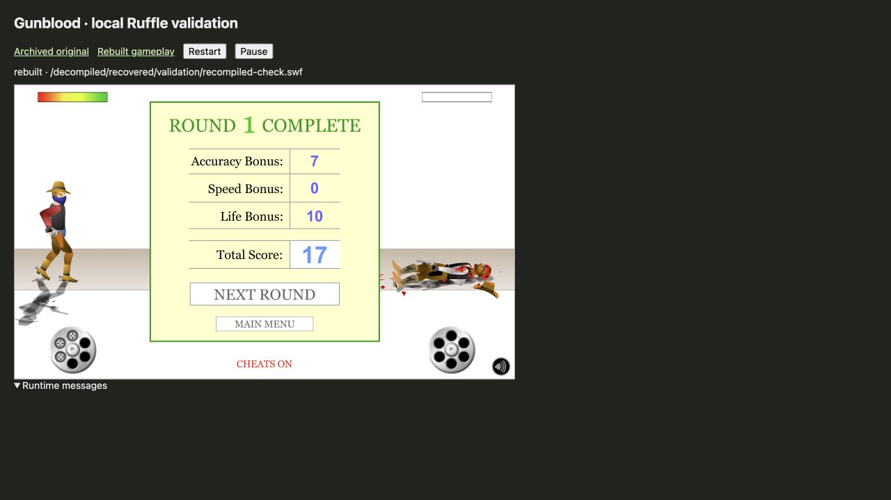

# Gunblood Source Code

Recovered ActionScript and extracted assets for **Gunblood**, the western pistol-dueling game by **Andrew Wolf / Wolf Games**.

This is an **unofficial decompilation and source recovery**, not the original authored Flash project. Start with [the readable gameplay source](decompiled/recovered/gameplay.as). See [NOTICE.md](NOTICE.md) for attribution and the limits of the available licensing information.

## Contents

| Path | Contents |
|---|---|
| [decompiled/recovered/gameplay.as](decompiled/recovered/gameplay.as) | Readable gameplay unit: 46 functions, with descriptive names and eight repaired parameter lists |
| [decompiled/recovered/RECOVERY.md](decompiled/recovered/RECOVERY.md) | Recovery method, limitations, name/register mappings and validation |
| [decompiled/export/scripts](decompiled/export/scripts) | All 251 script units from the initial extraction, preserved as reference; the improved gameplay unit is separate |
| [decompiled/export](decompiled/export) | 148 sounds, six images, six fonts, 304 vector shapes, three morph shapes, sprite/button/timeline SVG frames, text and symbol mappings |
| [decompiled/pcode/scripts](decompiled/pcode/scripts) | Original AVM1 P-code listings |
| [archive](archive) | Archived source SWF and provenance/checksums |
| [decompiled/recovered/validation/recompiled-check.swf](decompiled/recovered/validation/recompiled-check.swf) | Derived SWF containing the recovered gameplay unit |
| [runtime-validation](runtime-validation) | Local Ruffle harness, test report and screenshots |
| [tools](tools) | Reproduction and validation scripts |

## Play online

[Play the rebuilt game on GitHub Pages](https://atesahmet0.github.io/Gunblood-Source-Code/). The static player retains developer links and the original SWF ad hooks.

## Play locally

Requires Python 3.12+ for the runtime download helper. Download the pinned, integrity-checked Ruffle web runtime, then start a localhost server:

```sh
python3 tools/fetch-ruffle.py
sh tools/run-local-ruffle.sh
```

Open [the rebuilt game](http://127.0.0.1:8765/runtime-validation/?build=rebuilt) or [the archived original](http://127.0.0.1:8765/runtime-validation/?build=original). The runtime files are stored in ignored `tools/vendor/ruffle/`; no system installation is needed. The server binds to localhost. Online game services are not reconstructed.

## Validate the recovery

Requires Python 3 and Node.js 18+:

```sh
python3 tools/recover-gameplay.py
python3 tools/extract-gameplay-bytecode.py
node tools/validate-gameplay.cjs
```

The 176 deterministic cases compare recovered expressions against an interpreter executing the original function bytes. They cover 16 functions, including all ten functions that had unresolved pseudo-instructions in the initial gameplay export. Nested calls are stubbed consistently on both sides; this is not a whole-game equivalence proof.

To repeat decompilation and ActionScript compilation, install Java plus JPEXS FFDec [18.5.0](https://github.com/jindrapetrik/jpexs-decompiler/releases/tag/version18.5.0) and [26.3.0](https://github.com/jindrapetrik/jpexs-decompiler/releases/tag/version26.3.0), then run:

```sh
GUNBLOOD_JAVA_BIN=/path/to/java \
GUNBLOOD_FFDEC18_JAR=/path/to/ffdec18/ffdec.jar \
GUNBLOOD_FFDEC_JAR=/path/to/ffdec26/ffdec.jar \
sh tools/recover-gameplay.sh
```

FFDec marks AS1/2 compilation experimental. The recovered source still depends on the original SWF's timelines, symbols, assets, and other action blocks; it is not a standalone build of a recovered `.fla` project.

## Runtime verification

The rebuilt SWF was tested locally in Ruffle 0.7.1. Loading, menus, countdown, aiming/firing, damage/death, winning-round scores, progression to round two, and the first bonus round's missed-bottle completion path passed. The original SWF was a baseline for the ordinary win/progression path. No console warnings/errors were captured during the rebuilt tests.

Controlled win tests used the game's NOHIT cheat; the initial damage/loss test did not. The full nine-duel campaign, all bonus rounds, exact timing/scoring parity, audio fidelity, and online services remain unverified. See the [runtime report](runtime-validation/README.md).



## Provenance

- Original creator: **Andrew Wolf / Wolf Games**
- Official site: [gunblood.com](https://www.gunblood.com/)
- Archived game: [Internet Archive — gunblood_flash](https://archive.org/details/gunblood_flash)
- Input SWF SHA-1: `f3a4dbfed5daa55d4bc5e70645557b4865ffd801`

This repository does not claim an open-source license for the original game or its assets. Please retain the creator attribution and consult [NOTICE.md](NOTICE.md).

## GitHub Pages deployment

Pages publishes the `docs/` folder from `main`. To regenerate it, run `python3 tools/fetch-ruffle.py`, then `python3 tools/build-pages.py`, and commit the generated `docs/` files. The build pins Ruffle 0.7.1 and checks the rebuilt SWF against its validated SHA-256. The deployment contains the browser runtime and its licenses; Java/JPEXS tool binaries remain excluded. The local validation harness remains separate from the public player.
